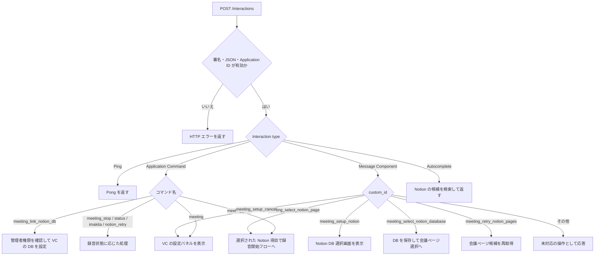
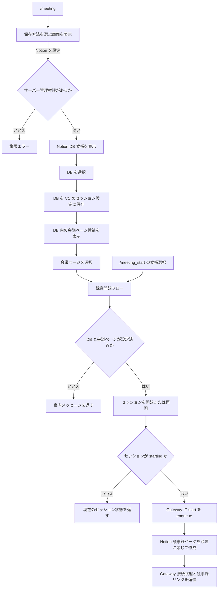

# Discord Interaction のフロー

Worker が受け取る Discord Interaction は HTTP リクエストとしては個別ですが、コマンド・ボタン・選択メニューを通じて複数の Interaction にまたがるフローもあります。この図は現在の実装における入口、分岐、録音開始までの処理を示します。

入口: [`discord-interactions.ts`](../apps/worker/src/api/discord-interactions.ts)。各入口の分岐は [`commands.ts`](../apps/worker/src/api/discord-interactions/commands.ts)、[`components.ts`](../apps/worker/src/api/discord-interactions/components.ts)、[`autocomplete.ts`](../apps/worker/src/api/discord-interactions/autocomplete.ts) にあり、Discord の画面生成は [`views.ts`](../apps/worker/src/api/discord-interactions/views.ts) にあります。

## Interaction の振り分け

コマンドは処理を `ExecutionContext.waitUntil` に登録してから応答します。通常は defer response（type 5）、ボタンや選択メニューでは defer update（type 6）を返し、後続処理で元の応答を更新します。Autocomplete は候補を同期的に返します。

## 設定から録音開始まで

`/meeting_start` の候補検索は、VC に設定済みの Notion DB を対象にします。`/meeting` から選んだ場合は、DB 選択後に同じ DB 内のページを選び、そのページを使って録音を開始します。Notion ページの初回作成に失敗しても録音開始要求は維持し、失敗内容を開始時の返信に含めます。

## その他のコマンド

| コマンド                  | 主な分岐・処理                                                                |
| ------------------------- | ----------------------------------------------------------------------------- |
| `/meeting_link_notion_db` | サーバー管理権限と DB 選択を確認し、VC の設定に保存                           |
| `/meeting_stop`           | 録音中または開始中なら Gateway に stop を enqueue。処理中などは現在状態を返信 |
| `/meeting_status`         | 有効なセッション、なければ直近のセッションと Gateway 接続状態を返信           |
| `/meeting_imakita`        | 録音中か、確定文字起こしがあるかを確認して Workers AI で要約                  |
| `/meeting_notion_retry`   | 直近の Notion 出力を再試行できるか確認して実行                                |

セッション状態は VC ごとの Durable Object に保存されます。Interaction をまたぐフローは Worker のメモリ状態ではなく、次に届く `custom_id` と保存済みのセッション設定をもとに進みます。
