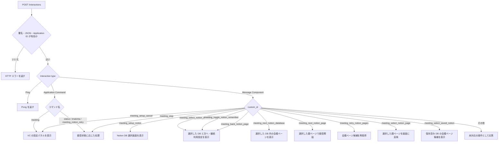
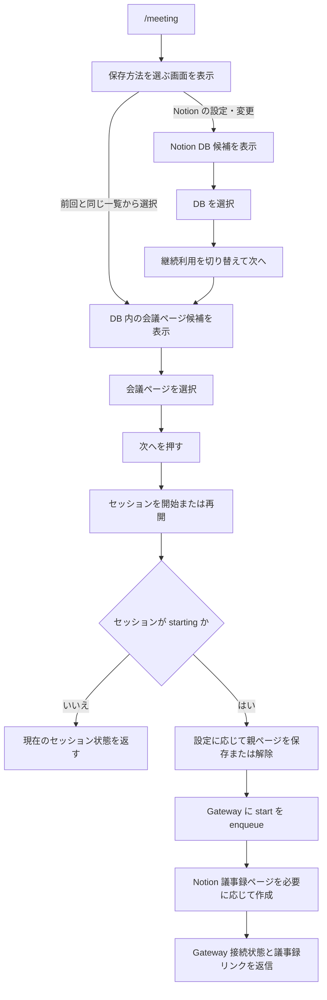

# Discord Interaction のフロー

Worker が受け取る Discord Interaction は HTTP リクエストとしては個別ですが、コマンド・ボタン・選択メニューを通じて複数の Interaction にまたがるフローもあります。この図は現在の実装における入口、分岐、録音開始までの処理を示します。

入口: [`discord-interactions.ts`](../apps/worker/src/api/discord-interactions.ts)。各入口の分岐は [`commands.ts`](../apps/worker/src/api/discord-interactions/commands.ts) と [`components.ts`](../apps/worker/src/api/discord-interactions/components.ts) にあり、Discord の画面生成は [`views.ts`](../apps/worker/src/api/discord-interactions/views.ts) にあります。

## Interaction の振り分け

コマンドは処理を `ExecutionContext.waitUntil` に登録してから応答します。通常は defer response（type 5）、ボタンや選択メニューでは defer update（type 6）を返し、後続処理で元の応答を更新します。

## 設定から録音開始まで

`/meeting` では Notion DB を選択してから「次へ」を押し、親ページを選んでもう一度「次へ」を押すと録音を開始します。「戻る」で DB 選択に戻れます。継続利用を有効にすると DB と親ページを VC ごとに保存し、次回の `/meeting` では同じ DB の会議ページ一覧を開いて選択できます。保存先を変更するときは「OFF」に切り替えると、次回以降の保存先設定を解除できます。Notion ページの初回作成に失敗しても録音開始要求は維持し、失敗内容を開始時の返信に含めます。

## その他のコマンド

| コマンド                | 主な分岐・処理                                                      |
| ----------------------- | ------------------------------------------------------------------- |
| `/status`               | 有効なセッション、なければ直近のセッションと Gateway 接続状態を返信 |
| `/imakinta`             | 録音中か、確定文字起こしがあるかを確認して Workers AI で要約        |
| `/meeting_notion_retry` | 直近の Notion 出力を再試行できるか確認して実行                      |

セッション状態と継続利用する親ページは VC ごとの Durable Object に保存されます。Interaction をまたぐ DB 選択と継続利用状態は画面の `custom_id` で継続し、会議ページを選んだ後に録音セッションを開始します。

録音中のメッセージにある「録音を終了」ボタンは、Gateway に stop を enqueue します。
